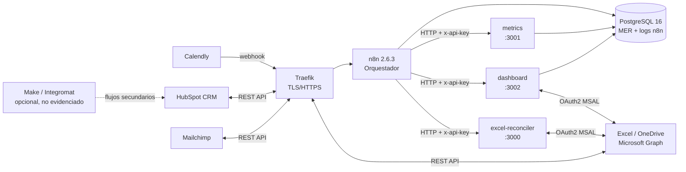

<div align="center">

# 🚀 Automatización de Procesos de Venta e Inversión mediante Integración de APIs y Herramientas No-code/Low-code para Emprendedores del Sector Fintech en Colombia

[](./LICENSE)
[](https://nodejs.org/)
[](https://n8n.io/)
[](./infrastructure/docker-compose.yml)
[]()

**Tesis de Grado — Ingeniería de Software**
*Objetivo Específico 5: Diseñar e implementar una arquitectura de automatización replicable para emprendedores Fintech colombianos sin grandes equipos de desarrollo.*

</div>

---

> [!CAUTION]
> **Descargo de responsabilidad legal**
>
> Este repositorio es un **artefacto académico de ingeniería de software** elaborado como prototipo funcional para una tesis de grado. El diseño técnico incorpora consideraciones derivadas de la **Ley 1581 de 2012** sobre Protección de Datos Personales de Colombia (principios de finalidad, seguridad, temporalidad y circulación restringida), como buena práctica de desarrollo de software responsable.
>
> Sin embargo, **este trabajo no constituye, ni pretende sustituir, una asesoría o auditoría jurídica formal**. El cumplimiento normativo efectivo de la Ley 1581/2012, el Decreto 1377 de 2013, las circulares de la Superintendencia Financiera de Colombia (SFC) y cualquier otra regulación sectorial aplicable al ámbito Fintech es responsabilidad exclusiva de cada organización y requiere la intervención de profesionales del derecho competentes. Los autores de este repositorio no asumen ninguna responsabilidad por el uso que terceros hagan del código aquí publicado en entornos de producción con datos reales de titulares.

---

## 📋 Tabla de Contenidos

1. [Descripción del Proyecto](#-descripción-del-proyecto)
2. [Arquitectura del Sistema](#-arquitectura-del-sistema)
3. [Stack Tecnológico](#-stack-tecnológico)
4. [Notas de versiones y desviaciones](#-notas-de-versiones-y-desviaciones)
5. [Requisitos Previos de Infraestructura](#-requisitos-previos-de-infraestructura)
6. [Estructura del Repositorio](#-estructura-del-repositorio)
7. [Guía de Implementación Rápida](#-guía-de-implementación-rápida)
8. [Flujos de Automatización](#-flujos-de-automatización)
9. [Configuración de Integraciones](#-configuración-de-integraciones)
10. [Verificación y Pruebas](#-verificación-y-pruebas)
11. [Consideraciones de Seguridad y Privacidad](#-consideraciones-de-seguridad-y-privacidad)
12. [Glosario para Emprendedores](#-glosario-para-emprendedores)
13. [Contribuciones](#-contribuciones)
14. [Licencia](#-licencia)

---

## 📌 Descripción del Proyecto

Este repositorio contiene el prototipo funcional de una arquitectura de **automatización de bajo costo** diseñada específicamente para **emprendedores y startups del sector Fintech colombiano** que:

- Operan con equipos pequeños (1–5 personas) sin desarrolladores de tiempo completo.
- Necesitan sincronizar datos entre su CRM, plataforma de email marketing, agenda de reuniones y reportes financieros en Excel.
- Buscan cumplir con buenas prácticas de seguridad de datos sin sacrificar agilidad operativa.

### ¿Qué problema resuelve?

| Proceso Manual (antes) | Proceso Automatizado (después) |
|---|---|
| Copiar leads de Calendly a HubSpot manualmente | Sincronización en tiempo real vía webhook |
| Enviar secuencias de Mailchimp de forma individual | Enrollment automático basado en etapa CRM |
| Actualizar portafolio de inversión en Excel a mano | Script Node.js que concilia vía Microsoft Graph API |
| Detectar discrepancias financieras de forma visual | Motor de conciliación con tolerancia configurable y reporte estructurado |
| Calcular a mano el tiempo y la tasa de error del proceso | Componente de métricas VD1/VD2 sobre datos reales de `automation_log` |
| Actualizar el tablero ejecutivo a mano cada semana | Dashboard de 4 bloques que actualiza el libro Excel en OneDrive |

---

## 🏛️ Arquitectura del Sistema

El sistema sigue un patrón de **orquestación centralizada con integraciones spoke**: n8n actúa como el hub central que coordina las señales entre todas las herramientas externas. Los cálculos de negocio que exceden lo que n8n resuelve de forma nativa viven en **microservicios Node.js** con API HTTP interna.

```
                          ┌─────────────────────────────────────────────────────────────────┐
                          │                     VPS AUTOALOJADO (Colombia)                    │
                          │                                                                   │
   ┌──────────────┐       │  ┌─────────────┐     ┌──────────────────────────────────────┐   │
   │   Calendly   │──────▶│  │   Traefik   │────▶│                n8n                   │   │
   │  (Webhooks)  │       │  │   TLS/HTTPS  │     │     Motor de Orquestación             │   │
   └──────────────┘       │  │ Let'sEncr. │     │                                      │   │
                          │  └─────────────┘     │  Workflow 1: Captura de Leads        │   │
   ┌──────────────┐       │                      │  Workflow 2: Sync Portafolio Excel    │   │
   │   HubSpot    │◀─────▶│                      │  Workflow 3: Secuencias de Email      │   │
   │     CRM      │       │                      │  Workflow 4: Alertas Financieras      │   │
   └──────────────┘       │                      │  Workflow 5: Reporte Semanal (RF-012)  │   │
                          │                      │  Workflow 6: Actualización Dashboard   │   │
   ┌──────────────┐       │                      └──────────┬───────────────────────────┘   │
   │  Mailchimp   │◀─────▶│                                 │                                │
   │   Campaigns  │       │                      ┌──────────▼───────────────────────────┐   │
   └──────────────┘       │                      │          PostgreSQL 16                │   │
                          │                      │    Base de datos persistente n8n     │   │
                          │                      │    + MER de negocio (6 entidades)     │   │
                          │                      │    (Red interna — no expuesta)       │   │
                          │                      └──────────────────────────────────────┘   │
                          │                                                                   │
   ┌──────────────┐       │  ┌────────────────────────────────────────────────────────┐     │
   │  Microsoft   │◀─────▶│  │            Servicios Node.js (API HTTP interna)          │     │
   │  365/OneDrive│       │  │  ┌────────────────┐  ┌────────────────┐  ┌────────────┐│     │
   │  Excel API   │       │  │  │ excel-reconciler│  │    metrics     │  │ dashboard  ││     │
   │              │       │  │  │ :3000          │  │ :3001          │  │ :3002      ││     │
   │              │       │  │  │ Graph · Decimal│  │ PostgreSQL     │  │ PostgreSQL ││     │
   │              │       │  │  │ MSAL · Zod     │  │ Zod · Stats    │  │ Graph · Zod ││     │
   │              │       │  │  └────────────────┘  └────────────────┘  └────────────┘│     │
   └──────────────┘       │  └────────────────────────────────────────────────────────┘     │
                          │                                                                   │
                          └─────────────────────────────────────────────────────────────────┘

   ┌────────────────────────────────────────────────────────────────────────────────────────┐
   │  Make (Integromat) — Capa complementaria No-code (OPCIONAL, sin escenarios exportados)  │
   │  Véase docs/decisions.md (ADR-009) para su estado real y los pasos de reproducción.      │
   └────────────────────────────────────────────────────────────────────────────────────────┘
```



### Roles de cada capa

| Componente | Rol | Tipo |
|---|---|---|
| **n8n** (self-hosted) | Orquestador principal. Procesa webhooks, ejecuta lógica condicional, llama APIs | Low-code |
| **Traefik** | Reverse proxy con TLS automático (Let's Encrypt). Expone n8n con HTTPS | Infraestructura |
| **PostgreSQL** | Almacena los workflows, las credenciales cifradas y los logs de ejecución de n8n, **y el MER de negocio** | Infraestructura |
| **`excel-reconciler`** | Conciliación financiera avanzada. Lógica que excede las capacidades de n8n nativo | Custom code |
| **`metrics`** | Cálculo de VD1/VD2 sobre las ejecuciones reales de `automation_log` | Custom code |
| **`dashboard`** | Dashboard ejecutivo de 4 bloques y escritura del libro Excel en OneDrive | Custom code |
| **Make (Integromat)** | Automatizaciones visuales complementarias de bajo código — **opcional, sin evidencia en el repositorio** | No-code |
| **HubSpot CRM** | Fuente de verdad del ciclo de vida del cliente (leads → clientes → inversores) | SaaS |
| **Mailchimp** | Motor de email marketing con segmentación por etapa del embudo | SaaS |
| **Calendly** | Captura de reuniones y onboarding de nuevos prospectos | SaaS |
| **Excel / OneDrive** | Repositorio de reportes financieros y portafolio de inversión | SaaS |

---

## 🔧 Stack Tecnológico

### Herramientas No-code / Low-code

| Herramienta | Versión mínima | Costo estimado (plan básico) | Caso de uso en este proyecto |
|---|---|---|---|
| [n8n](https://n8n.io/) | `2.6.3` (self-hosted) | \$0 (self-hosted) | Orquestación central de flujos |
| [Make](https://www.make.com/) | — | Desde \$9 USD/mes | Capa opcional, no verificada (ADR-009) |
| [HubSpot](https://www.hubspot.com/) | CRM Free o Starter | Desde \$0 | Gestión de contactos y pipeline |
| [Mailchimp](https://mailchimp.com/) | Essentials+ | Desde \$13 USD/mes | Campañas y automatización de email |
| [Calendly](https://calendly.com/) | Professional+ | Desde \$10 USD/mes | Agendamiento y webhooks de reuniones |
| [Microsoft 365](https://www.microsoft.com/es-co/microsoft-365) | Business Basic+ | Desde \$6 USD/mes | Excel en línea + OneDrive |

### Código y Servicios de Soporte

| Tecnología | Versión | Propósito |
|---|---|---|
| Node.js | >=18.0.0 (módulos nuevos) / >=20.0.0 (excel-reconciler) | Runtime de servicios Node.js personalizados |
| Docker + Docker Compose v2 | Estable | Contenerización de n8n, Traefik, PostgreSQL y los tres servicios Node.js |
| [Traefik](https://traefik.io/) | v3.6.7 | Reverse proxy + TLS automático con ACME/Let's Encrypt |
| PostgreSQL | 16 Alpine | Base de datos de n8n + tablas de negocio del MER (la tesis documenta PG 15; véase la nota de versiones) |
| `decimal.js` | ^10.4.3 | Aritmética financiera de precisión exacta (evita errores IEEE 754) |
| `zod` | ^4.6.7 | Validación de contratos de datos entre n8n y los servicios custom |
| `@azure/msal-node` | ^7.1.0 | Autenticación OAuth 2.0 con Microsoft Graph API |
| `pg` | ^8.13.1 | Cliente PostgreSQL de los servicios `metrics` y `dashboard` |
| `axios` / `axios-retry` | ^1.7.7 / ^4.5.0 | Cliente HTTP con reintentos para HubSpot, Mailchimp y Graph |

---

## ⚠️ Notas de versiones y desviaciones (diferencias vs. tesis IS25237)

La tesis documenta versiones específicas en §4.5.1 (tabla «Requisitos de software para el despliegue») y §3.6.5. A continuación se detalla el **estado real del repositorio** y la justificación de cada desviación. Las decisiones completas, con riesgos y limitaciones, están en **[`docs/decisions.md`](./docs/decisions.md)**.

| Componente | Versión tesis | Versión actual | Justificación |
|------------|--------------|----------------|---------------|
| **n8n** | 2.6.3 | **2.6.3** | Alineado exactamente con la tesis. Imagen `n8nio/n8n:2.6.3`. |
| **PostgreSQL** | 15 | **16 Alpine** | **Desviación documentada (ADR-002).** La versión anterior de este README justificaba la elección con una «incompatibilidad de `postgres:15-alpine` con `uuid-ossp` y `pg_trgm`»: **esa afirmación no era verificable y se ha retirado**. La razón real es de ciclo de vida y disponibilidad de la imagen oficial multi-arquitectura. **El esquema SQL es compatible con PostgreSQL 15 y 16** y se puede volver a PG 15 cambiando una línea (`image: postgres:15-alpine`) sin tocar el esquema. |
| **Traefik** | 2.10 | **3.6.7** | **Desviación documentada (ADR-002).** Traefik 2.10 está fuera de soporte; la rama 3 corrige vulnerabilidades e incorpora el control de acceso por IP que el §4.1.2 del documento describe. |
| **Node.js** | 18 LTS | **18** (módulos nuevos) / **20** (excel-reconciler) | El reconciliador usa `node:test` y `fetch` nativos con comportamiento estable desde Node 20. El resto de servicios mantiene 18 LTS, alineado con la tesis. |
| **Docker / Compose** | 24.0 / 2.20 | Los del host | Sin desviación. |
| **Ejecución de los scripts Node.js** | Nodo *Execute Command* (§4.5.3) | **Servicios HTTP en la red interna** | **Desviación justificada (ADR-005).** Un nodo *Execute Command* habilita la ejecución de procesos arbitrarios en el contenedor de n8n. La vía HTTP permite autenticar, validar y limitar la superficie expuesta, y es coherente con el servicio `excel-reconciler` que ya existía. |
| **OAuth 2.0 en las integraciones** | RF-011 / RNF-003 | Implementado en HubSpot, Mailchimp y Microsoft Graph; **desviación documentada en Calendly** | Ver **ADR-001**. El propio Manual Técnico (§4.5.2, paso quinto) prescribe Private App Token para HubSpot y Personal Token para Calendly: **el documento se contradice a sí mismo**. El repositorio implementa ambos modos y declara cuál está en uso. |
| **Base de datos** | MER de §4.3 (5 entidades + `campaign_lead`) | **Idéntico** | Validado entidad por entidad contra el §4.3 (ADR-011). ⚠️ **La Figura 5 del documento es un diagrama MER de otro diseño (borrador anterior)**: hay que regenerarla antes de la entrega. |
| **Dashboard ejecutivo** | §4.4 (prosa + mockup) | **Ambos** | El mockup y la descripción textual del §4.4 no coinciden entre sí; el componente implementa la unión de ambos, sin inventar indicadores (ADR-012). |
| **Capa Make** | «flujos secundarios en Make» (§3.6.1) | **Sin escenarios exportados** | No existe evidencia de uso en el repositorio. Se documenta como capa **opcional y no verificada** en **ADR-009**, con los pasos concretos que necesita un tercero para reproducirla. |

> ⚠️ **Nota sobre la numeración de los requerimientos.** El documento original contiene **dos versiones de las tablas de requerimientos** con identificadores distintos para el mismo requisito (RF-011 = OAuth 2.0 en la primera, panel de monitoreo en la segunda). Este repositorio usa la numeración de la primera tabla, que es la del enunciado del proyecto. El detalle está en **ADR-013**.

---

## 🖥️ Requisitos Previos de Infraestructura

Antes de comenzar la implementación, asegúrate de cumplir con todos los requisitos de esta sección. Están organizados por prioridad e impacto.

### 1. Servidor Virtual Privado (VPS)

Se requiere un VPS con acceso SSH root o sudo. El prototipo fue desarrollado y probado sobre Ubuntu 22.04 LTS.

| Recurso | Mínimo (dev/test) | Recomendado (producción) |
|---|---|---|
| CPU | 1 vCPU | 2 vCPU |
| RAM | 2 GB | 4 GB |
| Almacenamiento | 20 GB SSD | 50 GB SSD |
| SO | Ubuntu 22.04 LTS | Ubuntu 22.04 LTS |
| Ancho de banda | 1 TB/mes | Ilimitado o 3 TB/mes |

**Proveedores de VPS con presencia en Colombia / Latinoamérica recomendados:**

- [DigitalOcean](https://www.digitalocean.com/) — Droplet básico (~\$12 USD/mes). Datacenter en NYC/Toronto con baja latencia a Colombia.
- [Hetzner Cloud](https://www.hetzner.com/cloud) — CPX11 (~€4.15/mes). Opción económica en Europa.
- [Vultr](https://www.vultr.com/) — Instancia regular cloud (~\$12 USD/mes).
- [AWS EC2](https://aws.amazon.com/ec2/) — t3.small en us-east-1 (~\$17 USD/mes). Opción en zonas multi-región.

> [!TIP]
> Para un emprendimiento Fintech en Colombia que deba cumplir con la **soberanía del dato**, considera que la Ley 1581 de 2012 no prohíbe expresamente el alojamiento en servidores internacionales, pero sí impone el mismo estándar de seguridad. Consulta con tu equipo legal si procesas datos sensibles de categoría especial (salud financiera, biometría).

### 2. Dominio y DNS

- Un nombre de dominio registrado (ej: `tuempresa.com.co`). El NIC Colombia ([NIC.CO](https://www.nic.co/)) gestiona los dominios `.com.co`.
- Un subdominio apuntando al IP del VPS mediante registro tipo **A**:

  ```
  n8n.tuempresa.com.co  →  A  →  <IP_DE_TU_VPS>
  ```

- Si usas Cloudflare como DNS (recomendado), activa el modo **proxy naranja** para ocultar la IP real del servidor.

### 3. Software en el VPS

Instalar en el VPS antes de ejecutar el deploy:

```bash
# Actualizar sistema
sudo apt update && sudo apt upgrade -y

# Docker Engine (método oficial)
curl -fsSL https://get.docker.com | sh
sudo usermod -aG docker $USER

# Docker Compose V2 (viene incluido con Docker Engine moderno)
docker compose version   # Verificar: debe mostrar v2.x.x

# Utilidades necesarias
sudo apt install -y apache2-utils openssl git nano
```

### 4. Cuentas y Credenciales de Servicios Externos

Debes tener activas y configuradas las siguientes cuentas antes de iniciar:

| Servicio | Recurso a obtener | Dónde obtenerlo | Modo |
|---|---|---|---|
| **HubSpot** | App de desarrollador (OAuth 2.0) con `crm.objects.contacts.read/write` | [HubSpot Developer](https://developers.hubspot.com/) → Apps | `oauth2` (RF-011) |
| **HubSpot** *(alternativa)* | Private App Token | `Settings → Integrations → Private Apps` | `private_app` (**no es OAuth 2.0**) |
| **Mailchimp** | App registrada (OAuth 2.0) + `client_id` / `client_secret` | [Mailchimp Developer](https://mailchimp.com/developer/) → Registered Apps | `oauth2` (RF-011) |
| **Mailchimp** *(alternativa)* | API Key + Server Prefix | `Account → Extras → API keys` | `api_key` (**no es OAuth 2.0**) |
| **Calendly** | OAuth app (OAuth 2.1, PKCE) **o** Personal Access Token | [Calendly Developer](https://developer.calendly.com/) → OAuth apps / Personal access tokens | `oauth2` o `pat` — ver ADR-001 |
| **Calendly** | Webhook Signing Key | `Integrations → API & Webhooks` | — |
| **Microsoft 365** | App Registration en Azure AD con `Files.ReadWrite.All` y `Sites.ReadWrite.All` | `portal.azure.com → Azure Active Directory → App registrations` | OAuth 2.0 client credentials |
| **Email SMTP** | Credenciales SMTP para notificaciones del sistema n8n | Gmail con App Password, o Brevo (ex-Sendinblue) | — |

> La columna **«Modo»** importa: sólo `oauth2` satisface el RF-011. La tabla completa de decisión, riesgos y camino de transición está en [`docs/decisions.md` (ADR-001)](./docs/decisions.md).

### 5. Conocimientos Técnicos Mínimos Requeridos

Este repositorio está diseñado para ser replicable con conocimientos intermedios. No se requiere experiencia en desarrollo de software avanzado, pero sí es necesario:

- ✅ Conectarse a un servidor Linux vía SSH (`ssh usuario@IP`)
- ✅ Editar archivos de texto en terminal (`nano archivos.env`)
- ✅ Ejecutar comandos básicos de terminal (crear archivos, mover archivos, permisos)
- ✅ Crear una cuenta en una plataforma SaaS y ubicar su sección de API Keys
- ⚠️ Opcional pero recomendado: noción básica de JSON y variables de entorno

---

## 📁 Estructura del Repositorio

```
tesis-automatizacion-fintech/
├── 📄 README.md                          ← Este archivo
├── 📄 LICENSE                            ← Licencia MIT
├── 📄 .gitignore                         ← Archivos excluidos del repositorio
│
├── 📂 docs/                              ← Documentación técnica y de decisiones
│   ├── 📄 decisions.md                   ← Registro de decisiones (ADR-001 … ADR-010)
│   ├── 📄 DESIGN.md                      ← Sistema visual del dashboard Excel y de la documentación
│   └── 📂 contracts/                     ← Contratos de integración (5 documentos)
│       ├── 📄 hubspot.md
│       ├── 📄 mailchimp.md
│       ├── 📄 calendly.md
│       ├── 📄 metrics.md
│       └── 📄 dashboard.md
│
├── 📂 infrastructure/                    ← Infraestructura de despliegue (Docker)
│   ├── 🐳 docker-compose.yml             ← Traefik + n8n + PostgreSQL + 3 servicios Node.js
│   ├── 📄 .env.example                   ← Plantilla de variables de entorno
│   ├── 📜 deploy.sh                      ← Script de primer despliegue en VPS
│   ├── 📂 scripts/
│   │   └── 📄 verify-init.mjs            ← Verificación del esquema SQL sobre PostgreSQL limpio
│   └── 📂 config/
│       ├── 📂 traefik/                   ← Configuración estática y dinámica de Traefik
│       └── 📂 postgres/
│           └── init.sql                  ← Esquema idempotente del MER (6 entidades, 5 ENUMs)
│
├── 📂 workflows/                         ← Workflows n8n importables (6 archivos JSON)
│   ├── 📄 captura-leads.json
│   ├── 📄 conciliacion-excel.json
│   ├── 📄 secuencias-email.json
│   ├── 📄 alertas-financieras.json
│   ├── 📄 reporte-semanal.json           ← RF-012: invoca el componente metrics
│   └── 📄 actualizacion-dashboard.json   ← Actualiza el Excel en OneDrive
│
└── 📂 services/
    ├── 📂 common/                        ← Módulos compartidos entre servicios (sin dependencias)
    │   └── 📄 oauth2.js                  ← Proveedores de token OAuth 2.0 (cache, renovación, errores)
    ├── 📂 scripts/
    │   └── 📄 lint.mjs                   ← Lint compartido (sintaxis, secretos, debuggers)
    ├── 📂 excel-reconciler/              ← Servicio HTTP de conciliación financiera (:3000)
    ├── 📂 hubspot/                       ← Wrapper HubSpot API v3 + OAuth 2.0
    ├── 📂 mailchimp/                     ← Wrapper Mailchimp API v3 + OAuth 2.0
    ├── 📂 calendly/                      ← Wrapper Calendly API v2 + OAuth 2.1 / PAT
    ├── 📂 metrics/                       ← Componente de métricas VD1/VD2 (:3001)
    └── 📂 dashboard/                     ← Componente de dashboard ejecutivo (:3002)
```

---

## ⚡ Guía de Implementación Rápida

Sigue estos pasos en orden. Tiempo estimado para alguien sin experiencia previa en Docker: **2–4 horas**.

### Paso 1 — Clonar el repositorio

```bash
git clone https://github.com/Felipe937/tesis-automatizacion-fintech.git
cd tesis-automatizacion-fintech/infrastructure
```

### Paso 2 — Configurar variables de entorno

```bash
cp .env.example .env
chmod 600 .env          # CRÍTICO — contiene contraseñas
nano .env               # rellena TODOS los valores <REEMPLAZAR_...>
```

**Valores que debes generar de forma segura:**

```bash
# Contraseña para PostgreSQL (mínimo 32 caracteres)
openssl rand -base64 32

# Clave de cifrado para n8n (GUÁRDALA EN UN LUGAR SEGURO — sin ella pierdes todas las credenciales)
openssl rand -hex 32

# Hash de contraseña para el dashboard de Traefik
htpasswd -nB admin
# Copia el resultado y reemplaza cada $ por $$ en el archivo .env
```

### Paso 3 — Ejecutar el despliegue

```bash
chmod +x deploy.sh
sudo bash deploy.sh
```

El script verifica prerrequisitos, crea directorios con los permisos correctos, y levanta los contenedores en el orden correcto (Traefik → PostgreSQL → n8n → servicios Node.js).

### Paso 4 — Verificar el despliegue

```bash
docker compose ps                                     # estado de los 6 contenedores
curl -I https://n8n.tudominio.com.co                  # certificado TLS activo
docker compose logs -f n8n                            # logs de n8n

# Health checks de los servicios internos (desde la red de Docker)
docker compose exec n8n node -e "fetch('http://metrics:3001/health').then(r=>r.text()).then(console.log)"
docker compose exec n8n node -e "fetch('http://dashboard:3002/health').then(r=>r.text()).then(console.log)"
docker compose exec n8n node -e "fetch('http://excel-reconciler:3000/health').then(r=>r.text()).then(console.log)"
```

Accede a `https://n8n.tudominio.com` e inicia sesión con `N8N_BASIC_AUTH_USER` / `N8N_BASIC_AUTH_PASSWORD`.

### Paso 5 — Configurar las credenciales en n8n

Crea estas credenciales en n8n (las referencian los workflows con el nombre indicado):

| Tipo | Nombre | Datos |
|---|---|---|
| `Postgres` | `PostgreSQL n8n_fintech` | host `postgres`, puerto 5432, base `n8n_fintech`, usuario y contraseña del `.env` |
| `SMTP` | `SMTP n8n Fintech` | host, puerto, usuario y contraseña del `.env` |
| `HTTP Header Auth` | `Metrics API Key` | nombre del header **`x-api-key`**, valor = `METRICS_API_KEY` |
| `HTTP Header Auth` | `Dashboard API Key` | nombre del header **`x-api-key`**, valor = `DASHBOARD_API_KEY` |
| `HTTP Header Auth` | `Reconciler API Key` | nombre del header **`x-api-key`**, valor = `RECONCILER_API_KEY` |
| `HTTP Header Auth` | `HubSpot Private App` | nombre del header `Authorization`, valor `Bearer <token>` |
| `HTTP Header Auth` | `Mailchimp API Key` | nombre del header `Authorization`, valor `apikey <clave>` o `Bearer <token OAuth>` |

> En los JSON de los workflows las credenciales aparecen con `"id": "CONFIGURAR"`: es un marcador que n8n reemplaza al importar si existe una credencial con ese nombre.

### Paso 6 — Importar los workflows

En n8n: **Workflows → Import from File** y selecciona los seis archivos de `workflows/`. Después, en cada workflow, abre los nodos con credenciales y selecciónalas (el nombre debe coincidir con la tabla anterior).

### Paso 7 — Instalar y probar los servicios Node.js

```bash
cd ../services/metrics && npm ci && npm test
cd ../services/dashboard && npm ci && npm test
cd ../services/excel-reconciler && npm ci && npm test
```

> Los servicios también se ejecutan **dentro de Docker** (`docker compose up -d`). La instalación local sólo es necesaria para ejecutar las pruebas.

---

## 🔄 Flujos de Automatización

El repositorio incluye **seis archivos JSON de workflows** en `workflows/`, todos importables en n8n 2.6.3:

| # | Archivo | Nombre | Descripción | RF cubiertos |
|---|---------|--------|-------------|--------------|
| 1 | `captura-leads.json` | Captura Leads | Calendly webhook → HubSpot (buscar/crear contacto) → PostgreSQL (lead + appointment) → Mailchimp suscriptor → automation_log | RF-001 a RF-005 |
| 2 | `conciliacion-excel.json` | Conciliación Excel | Webhook → excel-reconciler (POST /reconcile) → evaluar resultado → responder | RF-008 a RF-010 (base) |
| 3 | `secuencias-email.json` | Secuencias Email | Schedule 15 min → detectar cambio HubSpot → Mailchimp tags → campaign_lead → automation_log | RF-003, RF-005 |
| 4 | `alertas-financieras.json` | Alertas Financieras | Schedule cron → HTTP excel-reconciler → evaluar status → automation_log (éxito/advertencia/error) → email admin | RF-008, RF-009, RF-010 |
| 5 | `reporte-semanal.json` | Reporte Semanal | Schedule lunes 8:00 am (America/Bogota) → idempotencia → `automation_log` → **componente metrics (HTTP)** → 4 indicadores de negocio → email al usuario piloto → log en automation_log | RF-012 |
| 6 | `actualizacion-dashboard.json` | Actualización Dashboard | Schedule diario 6:00 am → idempotencia → resumen MER (PostgreSQL) → **componente dashboard (HTTP)** → actualización del Excel en OneDrive → email → log en automation_log | §4.4 |

Todos los workflows incluyen:
- **Sin secretos hardcodeados**: credenciales vía gestor de n8n (`{{ $credentials }}`).
- **Idempotencia**: verificación antes de actuar (el reporte semanal y el dashboard omiten la ejecución si ya hubo una correcta en las últimas 12 h / 23 h).
- **Ramas de error**: cada nodo con `onError: continueErrorOutput` enruta el fallo a un nodo `Registrar Error` (insert en `automation_log` con `estado='error'`) y a un email de alerta al administrador.
- **Nodo anotación**: documentación del propósito del workflow dentro del propio flujo.

### Flujo 5 — Reporte semanal (RF-012) en detalle

```
   Schedule (lunes 8:00, America/Bogota)
        │
   Configuración (periodo ISO de la semana anterior, línea base, destinatario)
        │
   Verificar idempotencia ──(ya se envió)──▶ Fin
        │
   Consultar Ejecuciones Semana ──▶ automation_log del periodo
        │                                     (filas crudas, sin cálculos)
   Preparar Payload Métricas ──▶ POST http://metrics:3001/metrics
        │                                     │
        │                        ┌────────────┴────────────┐
        │                        │  media · mediana · desv.│
        │                        │  tasa de error · VD1/VD2│
        │                        │  aviso de muestra       │
        │                        │  insuficiente          │
        │                        └────────────┬────────────┘
   Consultar Indicadores Semana ──▶ 4 indicadores de negocio (SQL, con fuente documentada)
        │
   Construir Correo Reporte ──▶ unifica indicadores + métricas
        │
   Enviar Correo (SMTP) ──▶ Log Éxito / Log Error en automation_log
```

**Los cuatro indicadores de negocio y su fórmula exacta** (documentados en [`docs/contracts/metrics.md`](./docs/contracts/metrics.md) y en la anotación del workflow):

| Indicador | Fuente | Fórmula |
|---|---|---|
| `contactos_procesados` | `lead` | `COUNT(*)` con `fecha_registro` en el periodo — leads sincronizados con el CRM |
| `citas_registradas` | `appointment` | `COUNT(*)` con `fecha_hora_inicio` en el periodo — citas agendadas vía Calendly |
| `negocios_cerrados` | `lead` | `COUNT(*)` con `estado='cliente'` y `fecha_ultima_actualizacion` en el periodo |
| `flujos_fallidos` | `automation_log` | `COUNT(*)` con `estado='error'` en el periodo — fallos de **todos** los workflows |

> **Corrección aplicada:** la versión anterior calculaba `contactos_procesados` y `citas_registradas` con **la misma subconsulta** (`SUM(registros_procesados)` sobre `automation_log`), por lo que ambos indicadores devolvían el mismo número y contaban operaciones del workflow en lugar de contactos y citas. Véase ADR-006.

### Componentes de código personalizado (services/)

| Componente | Puerto | Descripción | RF/VS cubiertos |
|------------|--------|-------------|-----------------|
| `services/excel-reconciler/` | 3000 | Servicio de conciliación financiera (POST /reconcile vía Microsoft Graph) | RF-008 a RF-010 |
| `services/hubspot/` | — | Wrapper HubSpot API v3 (`getContact`, `createContact`, `updateContact`) + OAuth 2.0 | RF-001 a RF-005 |
| `services/mailchimp/` | — | Wrapper Mailchimp API v3 (`addOrUpdateMember`, `addTag`) + OAuth 2.0 | RF-001 a RF-005 |
| `services/calendly/` | — | Wrapper Calendly API v2 + validación HMAC de webhooks | RF-001 a RF-005 |
| `services/metrics/` | 3001 | Componente de métricas VD1/VD2 sobre `automation_log` real | VD1, VD2 (§2.4, §3.5) |
| `services/dashboard/` | 3002 | Dashboard ejecutivo de 4 bloques + escritura del Excel en OneDrive | §4.4 |
| `services/common/` | — | Módulos compartidos (OAuth 2.0) — sin dependencias | — |

### Capa Make (Integromat) — estado real

El README de versiones anteriores de este repositorio mencionaba tres escenarios de Make («Formularios Web → CRM», «Recordatorios SMS», «Exportaciones programadas») **sin ninguna exportación, blueprint ni captura que los respalde**.

**Lo que este repositorio sostiene hoy:** Make aparece en la arquitectura como **capa opcional y complementaria**, y su estado está documentado en **[ADR-009](./docs/decisions.md)**:

- **¿Se utilizó en el piloto?** No hay evidencia en el repositorio; no se afirma que se utilizara.
- **¿Por qué no hay exportaciones?** El repositorio se entrega sin credenciales ni configuraciones de terceros; los blueprints de Make contienen identificadores de conexión que no pueden publicarse.
- **¿Qué necesita un tercero para reproducirlo?** Registrar la app en Make, definir los tres escenarios, exportar cada uno a JSON y versionarlos en `workflows/make/` junto con su documentación, y apuntar cada webhook al endpoint de n8n ya existente.
- **¿Qué limitaciones implica?** Las ejecuciones de Make **no quedan trazadas** en `automation_log` (la base de la trazabilidad VD1/VD2) y esa parte de la arquitectura no es reproducible.

---

## ⚙️ Configuración de Integraciones

### HubSpot CRM — OAuth 2.0 (RF-011)

1. En [HubSpot Developer](https://developers.hubspot.com/) crea una **app de desarrollador** y registra el Redirect URI `https://n8n.tudominio.com.co/rest/oauth2-credential/callback`.
2. Concede los scopes `crm.objects.contacts.read`, `crm.objects.contacts.write`, `crm.objects.deals.read`, `crm.objects.deals.write`.
3. Completa el consentimiento y obtén el **refresh token**.
4. Configura en el `.env`:
   ```bash
   HUBSPOT_AUTH_MODE=oauth2
   HUBSPOT_CLIENT_ID=...
   HUBSPOT_CLIENT_SECRET=...
   HUBSPOT_REFRESH_TOKEN=...
   HUBSPOT_REDIRECT_URI=https://n8n.tudominio.com.co/rest/oauth2-credential/callback
   ```
5. El cliente renueva el access token automáticamente 60 s antes de expirar y reintenta **una vez** ante un 401.

**Modo alternativo (no cumple RF-011):** `HUBSPOT_AUTH_MODE=private_app` con `HUBSPOT_ACCESS_TOKEN` (Private App Token `pat-na1-…`). Se mantiene por compatibilidad y está **declarado como tal** en el código, en el contrato y en ADR-001.

### Mailchimp — OAuth 2.0 (RF-011)

1. En [Mailchimp Developer](https://mailchimp.com/developer/) → **Registered Apps** → *Register An App*. Guarda `client_id` y `client_secret` (el secret sólo se muestra una vez).
2. Registra el Redirect URI `https://n8n.tudominio.com.co/rest/oauth2-credential/callback`.
3. Completa el flujo de autorización: obtienes un `code` y lo cantes por un access token.
4. Configura en el `.env`:
   ```bash
   MAILCHIMP_AUTH_MODE=oauth2
   MAILCHIMP_CLIENT_ID=...
   MAILCHIMP_CLIENT_SECRET=...
   MAILCHIMP_OAUTH_CODE=...
   MAILCHIMP_SERVER_PREFIX=us21   # datacenter (obligatorio en modo OAuth)
   ```
5. **Los tokens de Mailchimp no expiran**: no hay `refresh_token` ni rotación. Si el usuario revoca el acceso, la API responde 401 y el cliente lo traduce a un error que pide rehacer la autorización.

**Modo alternativo (no cumple RF-011):** `MAILCHIMP_AUTH_MODE=api_key` con `MAILCHIMP_API_KEY`.

### Calendly — OAuth 2.1 o Personal Access Token

1. **OAuth 2.1 (conforme):** en [Calendly Developer](https://developer.calendly.com/) → *OAuth apps* → crea la app, registra el Redirect URI y **obtén el token mediante el flujo Authorization Code + PKCE S256** (lo emite Calendly tras el consentimiento del usuario). Guárdalo en `CALENDLY_ACCESS_TOKEN` y pon `CALENDLY_AUTH_MODE=oauth2`.
2. **Personal Access Token (modo del piloto):** `Profile → Developer → Personal access tokens` → genera el token → `CALENDLY_API_TOKEN` con `CALENDLY_AUTH_MODE=pat`. **No es OAuth 2.0** (ADR-001).
3. **Webhook:** crea un webhook apuntando a `https://n8n.tudominio.com/webhook/calendly-events` y guarda su *Signing Key* en `CALENDLY_WEBHOOK_SIGNING_KEY`.

### Microsoft 365 / Excel / OneDrive — OAuth 2.0 (App Registration)

1. En [portal.azure.com](https://portal.azure.com) → **Azure Active Directory → App registrations → New registration**.
2. En **Redirect URIs** agrega: `https://n8n.tudominio.com.co/rest/oauth2-credential/callback`.
3. En **API Permissions** agrega (tipo Application): `Files.ReadWrite.All`, `Sites.ReadWrite.All`.
4. **Grant admin consent**.
5. En **Certificates & secrets** crea un *Client Secret* (anota el valor: sólo se muestra una vez).
6. Anota el **Application (client) ID** y el **Directory (tenant) ID**.

**Identificadores que necesitas:**

```bash
# DriveItem ID del libro del dashboard (Graph Explorer)
GET https://graph.microsoft.com/v1.0/me/drive/root:/Dashboard.xlsx
# → campo "id"

# Igual para el libro de portafolio que usa el reconciliador
GET https://graph.microsoft.com/v1.0/me/drive/root:/Portafolio.xlsx
```

Configura en el `.env`: `MICROSOFT_CLIENT_ID`, `MICROSOFT_CLIENT_SECRET`, `MICROSOFT_TENANT_ID`, `DASHBOARD_EXCEL_DRIVE_ITEM_ID` y `DASHBOARD_EXCEL_WORKSHEET`.

---

## 🧪 Verificación y Pruebas

Cada servicio trae sus propias pruebas unitarias y de integración (datos sintéticos, sin llamadas a APIs externas).

| Servicio | Comando | Qué cubre |
|---|---|---|
| `services/common` | `npm test` | Proveedores de token OAuth 2.0: caché, renovación, revocación, errores de red |
| `services/excel-reconciler` | `npm test` | Motor de conciliación (Decimal.js), cliente Graph y servidor HTTP |
| `services/hubspot` | `npm test` | Modos de autenticación, reintento tras 401, mapeo de errores HTTP, validación Zod |
| `services/mailchimp` | `npm test` | Cabecera `apikey` vs `Bearer`, datacenter, errores HTTP, `subscriberHash` |
| `services/calendly` | `npm test` | HMAC de webhooks, modos de autenticación, expiración de token, errores HTTP |
| `services/metrics` | `npm test` | Estadísticas, datos reales vs sintéticos, periodos vacíos, latencias nulas, muestras insuficientes, fallos de PostgreSQL, servidor HTTP |
| `services/dashboard` | `npm test` | Los cuatro bloques, consulta del MER, construcción del Excel y sus formatos, fallos de PostgreSQL y de OneDrive, servidor HTTP |

```bash
# Lint de todos los servicios (sintaxis, secretos literales, debugger, .only)
cd services/metrics    && npm run lint
cd services/dashboard  && npm run lint
cd services/excel-reconciler && npm run lint

# Verificación del esquema SQL sobre un PostgreSQL limpio (requiere Docker)
node infrastructure/scripts/verify-init.mjs
```

El lint es una implementación propia y sin dependencias externas (`services/scripts/lint.mjs`): valida sintaxis con `node --check` y rechaza `debugger`, `.only()` y patrones de credenciales literales. **No imprime el valor de un secreto detectado**, sólo su tipo. Véase ADR-008.

CI (`.github/workflows/ci.yml`) ejecuta el lint y las pruebas de todos los servicios en cada *push* y *pull request*.

---

## 🔗 Trazabilidad con la tesis

Cada requisito del documento original y su correspondencia en el repositorio. Las discrepancias internas del documento (doble numeración de RF/RNF, MER de la Figura 5, mockup frente a descripción del §4.4) están documentadas en [`docs/decisions.md`](./docs/decisions.md).

| Requisito (tesis) | Implementación | Evidencia |
|---|---|---|
| **RF-011** — OAuth 2.0 con tokens cifrados y renovados | `services/common/oauth2.js` + clientes | `oauth2.test.js` (14 + 31 pruebas) |
| **RNF-003** — HTTPS + OAuth 2.0, credenciales cifradas en n8n | Compose, `.env.example`, `.gitignore` | Auditoría de seguridad: 0 secretos |
| **RF-007 / RF-010** — Reintentos (3 intentos, 30 s / exponencial) | Clientes HTTP (`axios-retry`) | `oauth.test.js`, `client.test.js` |
| **RF-008 / RF-009** — Log de ejecuciones en PostgreSQL | `automation_log` + workflows | `verify-init.mjs`, `integration.test.js` |
| **RF-009 / RF-008** — Notificación por correo ante fallo | `emailSend` en todos los workflows | Revisión de conexiones |
| **RF-012** — Reporte semanal (lunes 8:00) | `workflows/reporte-semanal.json` + `services/metrics` | 35 pruebas de metrics |
| **§2.4 VD1 / VD2** — Variables dependientes | `services/metrics/src/calculator.js` | `calculator.test.js` (22), `service.test.js` (23) |
| **§3.4.3** — Telemetría (latencia, ejecuciones, volumen, fallas) | `automation_log` | `verify-init.mjs` |
| **§3.5** — Estadística descriptiva (media, mediana, desviación) | `services/metrics/src/calculator.js` | `calculator.test.js` |
| **§4.3** — MER (5 entidades + `campaign_lead`) | `infrastructure/config/postgres/init.sql` | `verify-init.mjs` (12) |
| **§4.4** — Dashboard ejecutivo (4 bloques + mockup) | `services/dashboard` + `workflows/actualizacion-dashboard.json` | 63 pruebas de dashboard |
| **§4.5.2** — Instalación en 5 pasos | Este README, §«Guía de Implementación» | — |
| **§4.5.3** — Cuatro módulos Node.js | `hubspot/`, `mailchimp/`, `calendly/`, `graphClient.js` | — |
| **RNF-001** — Rendimiento (≤ 10 s) | Métricas de latencia | `calculator.test.js` |
| **RNF-002** — Disponibilidad 99 % | `restart: unless-stopped` + healthchecks | — |
| **RNF-005** — Mantenibilidad (JSDoc, anotaciones, README) | Todos los servicios | `npm run lint` (49 ficheros) |
| **RNF-006** — Portabilidad | Compose + Dockerfiles | `docker compose config` (6 servicios) |
| **Ley 1581/2012** — Protección de datos | `.gitignore`, `.env.example`, servicios | Auditoría de seguridad |

### Notas operativas del documento original

- **Plan de Mailchimp** (§3.6.5): el piloto usa el **plan gratuito** — 1.000 correos/mes y 500 contactos. Para más volumen basta cambiar las credenciales en el `.env`; el flujo no se modifica.
- **Respaldo de la base de datos** (§3.6.5): el sistema **no incluye alta disponibilidad ni respaldo automático**. Durante la validación, el respaldo se hace **manualmente una vez por semana** con `pg_dump` almacenado en OneDrive.
- **Límites de tasa por proveedor** (§3.6.5): HubSpot 100 peticiones/10 s (cuentas Professional), Mailchimp 10 peticiones/s, Calendly 1.500/minuto, Microsoft Graph 5 peticiones concurrentes por aplicación.
- **Ventana de mantenimiento** (RNF-001, 1ª versión): domingos de 2:00 a 4:00 a. m.

---

## 🔐 Consideraciones de Seguridad y Privacidad

Este proyecto incorpora las siguientes medidas técnicas como buenas prácticas de ingeniería de software. **No reemplazan una auditoría de seguridad profesional.**

| Medida | Implementación | Principio Ley 1581 relacionado |
|---|---|---|
| **Cifrado en tránsito** | TLSv1.2/1.3 obligatorio (Traefik + Let's Encrypt) | Art. 17 — Deber de seguridad |
| **Cifrado en reposo** | `N8N_ENCRYPTION_KEY` (AES-256 para credenciales) | Art. 17 — Deber de seguridad |
| **Red interna aislada** | PostgreSQL en red Docker `internal: true` | Art. 17 — Circulación restringida |
| **Servicios sin exposición** | `metrics`, `dashboard` y `excel-reconciler` no publican puertos al host | Art. 17 — Circulación restringida |
| **Autenticación interna** | Header `x-api-key` con comparación en tiempo constante | Art. 17 — Acceso controlado |
| **Sin telemetría** | `N8N_DIAGNOSTICS_ENABLED=false` | Art. 10 — Principio de finalidad |
| **Retención limitada** | `EXECUTIONS_DATA_MAX_AGE=90` días | Art. 9 — Principio de temporalidad |
| **Cabeceras OWASP** | HSTS, CSP, X-Frame-Options, XSS-Filter | OWASP Secure Headers |
| **Rate limiting** | 100 req/s global, 30 req/s en APIs | Art. 17 — Protección contra abuso |
| **Secretos fuera del repo** | `.env` en `.gitignore`, permisos 600 | Art. 17 — Acceso controlado |
| **Estado de certificados fuera del repo** | `infrastructure/traefik/certs/` ignorado (contiene claves ACME) | Art. 17 — Acceso controlado |
| **Logs sin datos personales** | Los servicios registran workflow, duración y estado; nunca correos, nombres ni tokens | Art. 8 — Principios de tratamiento |
| **Datos de demostración neutros** | Fixtures sin nombres ni correos de personas reales | Art. 5 — Datos personales |

### Recomendaciones adicionales para producción

- [ ] Configurar backups cifrados diarios de PostgreSQL (ver [`deploy.sh`](./infrastructure/deploy.sh) para el script de backup con GPG). El §3.6.5 de la tesis asume un **`pg_dump` manual semanal** almacenado en OneDrive.
- [ ] Implementar autenticación de dos factores (2FA) en todas las cuentas SaaS (HubSpot, Mailchimp, Calendly, Microsoft 365).
- [ ] Registrar un Responsable de Protección de Datos (RPD) si tu Fintech procesa datos personales de más de 1.000 titulares.
- [ ] Publicar el Aviso de Privacidad en tu sitio web antes de recolectar datos de prospectos vía Calendly.
- [ ] Activar la IP Allowlist en [`config/traefik/dynamic.yml`](./infrastructure/config/traefik/dynamic.yml) para restringir el acceso al editor de n8n a las IPs de tu equipo.
- [ ] **Rotar el secreto de la cuenta ACME** si el `acme.json` llegó a versionarse en un clon ya publicado (en el estado actual del repositorio el fichero está vacío: no hay material criptográfico que rotar).

---

## 📖 Glosario para Emprendedores

Términos técnicos usados en este repositorio, explicados en lenguaje cotidiano:

| Término | Explicación sencilla |
|---|---|
| **API** | Una "puerta trasera digital" que permite que dos aplicaciones se comuniquen entre sí de forma automática. |
| **Webhook** | Un aviso automático que una app envía a otra cuando ocurre un evento (ej: "se agendó una reunión en Calendly"). |
| **OAuth 2.0** | El permiso que das a otra aplicación para actuar en tu nombre, sin compartir tu contraseña. Se puede revocar cuando quieras. |
| **Personal Access Token** | Una contraseña larga y revocable que genera Calendly para un programa interno. Es como un OAuth simplificado de un solo uso. |
| **VPS** | Un servidor en la nube que tú controlas completamente, como alquilar un computador que siempre está prendido en internet. |
| **n8n** | Una plataforma visual (como Lego) para crear automatizaciones conectando distintas aplicaciones. Se autoaloja en tu VPS. |
| **Docker** | Una tecnología que empaca el software en "cajas" (contenedores) que funcionan igual en cualquier servidor. |
| **TLS/HTTPS** | El candado verde del navegador. Cifra la información para que nadie pueda interceptarla en tránsito. |
| **MER** | El "Modelo Entidad-Relación": el dibujo que define qué tablas tiene el sistema y cómo se relacionan. |
| **Idempotencia** | Poder ejecutar la misma acción varias veces sin que se duplique el resultado (como un interruptor que no acumula). |
| **Dashboard** | El tablero-resumen que muestra de un vistazo cómo va el negocio: ventas, citas, dinero. |
| **OneDrive** | El almacenamiento de archivos de Microsoft 365. Allí se guarda el libro de Excel que ve el asesor. |
| **Conciliación financiera** | El proceso de comparar dos fuentes de datos financieros para detectar diferencias o errores. |
| **Variables de entorno** | Configuraciones secretas (contraseñas, tokens) que se guardan fuera del código por seguridad. |
| **Ley 1581 de 2012** | La ley colombiana que regula cómo las empresas pueden recolectar, almacenar y usar datos personales de sus clientes. |

---

## 🤝 Contribuciones

Las contribuciones son bienvenidas. Por favor:

1. Haz un fork del repositorio.
2. Crea una rama descriptiva: `git checkout -b feat/nombre-del-cambio`.
3. Haz commit de tus cambios con mensajes claros: `git commit -m "feat: descripción del cambio"`.
4. Abre un Pull Request describiendo qué cambiaste y por qué.

Si encuentras un bug de seguridad, por favor **no abras un issue público**. Reporta la vulnerabilidad de forma responsable directamente al autor.

---

## 📄 Licencia

Este proyecto se publica bajo la **Licencia MIT**.

Puedes usar, copiar, modificar, distribuir y sublicenciar el código de este repositorio, incluso con fines comerciales, siempre que incluyas el aviso de copyright y la licencia en todas las copias o partes sustanciales del software.

Ver el archivo [LICENSE](./LICENSE) para el texto completo.

---

<div align="center">

**Hecho con ❤️ para el ecosistema emprendedor Fintech de Colombia**

*Tesis de Grado — Ingeniería de Software · 2026*

</div>
