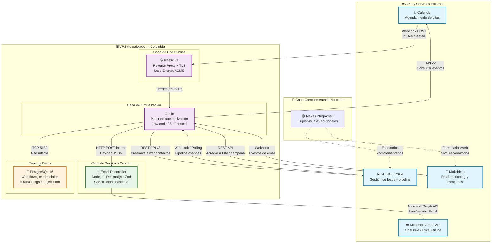

# 🏛️ Arquitectura Global de Integración de APIs

> **Proyecto:** Automatización de Procesos de Venta e Inversión — Fintech Colombia  
> **Tesis:** Universidad Manuela Beltrán (UMB) · IS25237  
> **Última actualización:** Noviembre 2026

## Descripción

Este diagrama representa la arquitectura de integración completa del sistema. El orquestador
central (n8n) coordina los flujos de datos entre las APIs externas (HubSpot, Mailchimp,
Calendly, Microsoft Graph) y los servicios internos (Excel Reconciler, PostgreSQL).

## Diagrama de Arquitectura

## Tabla de Componentes

| Componente | Tipo | Protocolo | Rol en el Sistema |
|---|---|---|---|
| **Traefik** | Reverse Proxy | HTTPS/TLS 1.2-1.3 | Punto de entrada único, TLS automático con Let's Encrypt |
| **n8n** | Orquestador | HTTP interno | Hub central que coordina todos los flujos de automatización |
| **PostgreSQL** | Base de datos | TCP 5432 (interno) | Persistencia de workflows, credenciales cifradas y ejecuciones |
| **Excel Reconciler** | Microservicio | HTTP interno | Conciliación financiera con aritmética de precisión exacta |
| **HubSpot CRM** | SaaS externo | REST API v3 | Fuente de verdad del ciclo de vida del cliente |
| **Mailchimp** | SaaS externo | REST API v3 | Motor de email marketing con segmentación |
| **Calendly** | SaaS externo | Webhooks + API v2 | Captura de reuniones y onboarding de prospectos |
| **Microsoft Graph** | SaaS externo | REST API v1.0 | Lectura y escritura de archivos Excel en OneDrive |
| **Make (Integromat)** | SaaS externo | HTTP/REST | Automatizaciones visuales complementarias |

## Flujo de Datos Principal

1. **Ingreso de leads**: Un prospecto agenda una reunión en Calendly → webhook llega a Traefik → n8n lo procesa.
2. **Enriquecimiento CRM**: n8n crea o actualiza el contacto en HubSpot CRM con los datos del prospecto.
3. **Activación de email**: n8n agrega al contacto en la lista correspondiente de Mailchimp e inicia la secuencia de bienvenida.
4. **Conciliación financiera**: n8n envía transacciones al Excel Reconciler → el servicio lee el Excel de OneDrive, compara con Decimal.js, y escribe los resultados de vuelta.
5. **Persistencia**: Todos los logs de ejecución y credenciales se almacenan cifrados en PostgreSQL.
