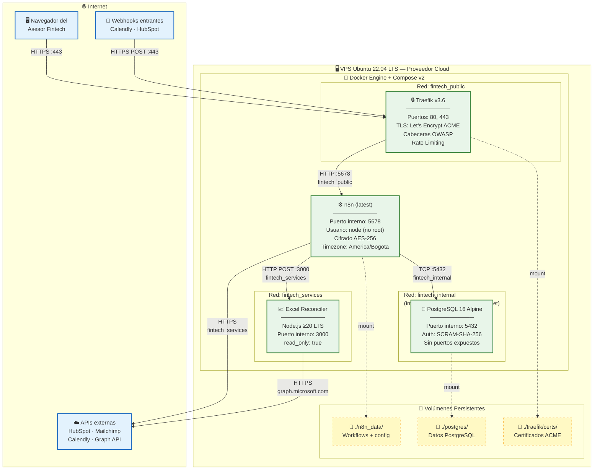

# 🚀 Diagrama de Despliegue

> **Proyecto:** Automatización de Procesos de Venta e Inversión — Fintech Colombia  
> **Tesis:** Universidad Manuela Beltrán (UMB) · IS25237  
> **Última actualización:** Noviembre 2026

## Descripción

Este diagrama muestra la topología de despliegue del sistema: contenedores Docker,
redes internas, volúmenes persistentes y la comunicación con servicios externos.
El diseño prioriza el aislamiento de red y el cifrado en tránsito y en reposo
conforme a buenas prácticas derivadas de la Ley 1581 de 2012.

## Diagrama de Despliegue

## Tabla de Contenedores

| Contenedor | Imagen | Red(es) | Puerto Expuesto | Seguridad |
|---|---|---|---|---|
| `traefik` | `traefik:v3.6.7` | fintech_public | 80, 443 | `no-new-privileges`, socket Docker read-only |
| `n8n` | `n8nio/n8n:latest` | public + internal + services | Ninguno (vía Traefik) | Usuario `node`, cifrado AES-256, sin telemetría |
| `n8n_postgres` | `postgres:16-alpine` | fintech_internal | Ninguno | SCRAM-SHA-256, red interna aislada |
| `excel-reconciler` | Build local | fintech_services | Ninguno | `read_only: true`, `no-new-privileges` |

## Redes Docker

| Red | Tipo | Acceso a Internet | Propósito |
|---|---|---|---|
| `fintech_public` | bridge | ✅ Sí | Traefik expone puertos 80/443 al exterior |
| `fintech_internal` | bridge (internal) | ❌ No | Comunicación n8n ↔ PostgreSQL aislada |
| `fintech_services` | bridge | ✅ Sí (saliente) | Excel Reconciler necesita acceder a Microsoft Graph API |

## Requisitos del VPS

| Recurso | Mínimo (dev/test) | Recomendado (producción) |
|---|---|---|
| CPU | 1 vCPU | 2 vCPU |
| RAM | 2 GB | 4 GB |
| Almacenamiento | 20 GB SSD | 50 GB SSD |
| SO | Ubuntu 22.04 LTS | Ubuntu 22.04 LTS |
