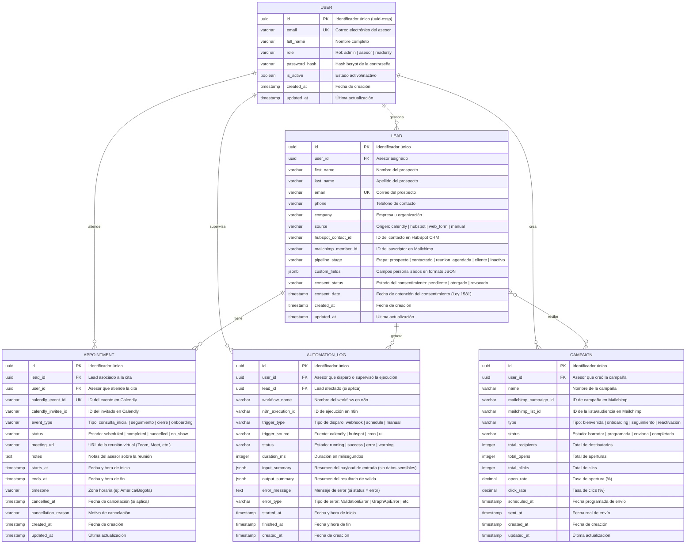

# 🗄️ Modelo Entidad-Relación — Base de Datos PostgreSQL

> **Proyecto:** Automatización de Procesos de Venta e Inversión — Fintech Colombia  
> **Tesis:** Universidad Manuela Beltrán (UMB) · IS25237  
> **Última actualización:** Noviembre 2026

## Descripción

Este modelo Entidad-Relación representa la estructura de datos del sistema de automatización.
La base de datos PostgreSQL 16 almacena la información de leads, campañas de email marketing,
citas agendadas, logs de automatización y usuarios del sistema.

> **Nota:** n8n gestiona internamente sus propias tablas (workflows, credenciales cifradas,
> ejecuciones). Las entidades aquí documentadas son las del **dominio de negocio** del
> emprendimiento Fintech, accesibles tanto por n8n como por los servicios custom.

## Diagrama Entidad-Relación



## Descripción de Entidades

### `USER` — Usuarios del Sistema
Representa a los asesores fintech y administradores que operan el sistema de automatización.
Cada usuario tiene un rol que determina sus permisos de acceso.

### `LEAD` — Prospectos y Clientes
Almacena la información de los prospectos capturados desde múltiples fuentes (Calendly, HubSpot,
formularios web). Incluye campos de sincronización con HubSpot y Mailchimp, así como el estado
del consentimiento de tratamiento de datos (Ley 1581 de 2012).

### `CAMPAIGN` — Campañas de Email Marketing
Registra las campañas de Mailchimp sincronizadas con el sistema. Incluye métricas de rendimiento
(aperturas, clics) para análisis del embudo de ventas.

### `APPOINTMENT` — Citas Agendadas
Almacena las reuniones agendadas a través de Calendly, vinculadas al lead y al asesor correspondiente.
Permite rastrear el ciclo completo de la reunión (agendada → completada/cancelada).

### `AUTOMATION_LOG` — Registro de Automatizaciones
Log detallado de cada ejecución de los workflows de n8n. Incluye el tipo de disparo, duración,
estado final y resúmenes de entrada/salida para auditoría. No almacena datos personales
sensibles en los campos de resumen (cumplimiento Ley 1581).

## Índices Recomendados

```sql
-- Búsqueda frecuente de leads por email y etapa del pipeline
CREATE INDEX idx_lead_email ON lead (email);
CREATE INDEX idx_lead_pipeline_stage ON lead (pipeline_stage);
CREATE INDEX idx_lead_source ON lead (source);

-- Búsqueda de citas por fecha y estado
CREATE INDEX idx_appointment_starts_at ON appointment (starts_at);
CREATE INDEX idx_appointment_status ON appointment (status);

-- Consulta de logs por fecha y estado de ejecución
CREATE INDEX idx_automation_log_started_at ON automation_log (started_at);
CREATE INDEX idx_automation_log_status ON automation_log (status);
CREATE INDEX idx_automation_log_workflow ON automation_log (workflow_name);

-- Búsqueda full-text con pg_trgm (habilitado en init.sql)
CREATE INDEX idx_lead_name_trgm ON lead USING gin (first_name gin_trgm_ops);
```
