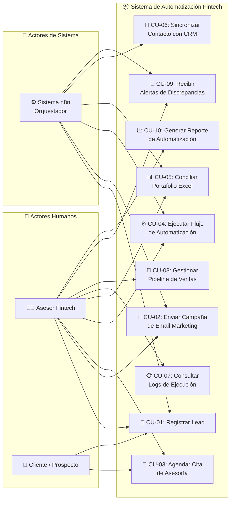

# 📋 Diagrama de Casos de Uso

> **Proyecto:** Automatización de Procesos de Venta e Inversión — Fintech Colombia  
> **Tesis:** Universidad Manuela Beltrán (UMB) · IS25237  
> **Última actualización:** Noviembre 2026

## Descripción

Este diagrama presenta los casos de uso principales del sistema de automatización.
Se identifican tres actores: el **Asesor Fintech** (usuario humano principal),
el **Sistema n8n** (orquestador automatizado) y el **Cliente** (prospecto/inversionista).

## Diagrama de Casos de Uso

## Especificación de Casos de Uso

### CU-01: Registrar Lead

| Campo | Descripción |
|---|---|
| **Actores** | Asesor Fintech, Cliente, Sistema n8n |
| **Precondición** | El prospecto no existe previamente en el sistema |
| **Flujo principal** | 1. El cliente completa un formulario web o agenda una reunión en Calendly. 2. El webhook llega a n8n vía Traefik. 3. n8n valida la estructura del payload. 4. n8n crea el contacto en HubSpot CRM. 5. n8n registra el lead en PostgreSQL. 6. n8n agrega al lead a la lista de Mailchimp correspondiente. |
| **Flujo alternativo** | Si el lead ya existe en HubSpot, n8n actualiza la etapa del pipeline en lugar de crear uno nuevo. |
| **Postcondición** | El lead queda registrado en HubSpot, PostgreSQL y Mailchimp con estado "prospecto". |
| **APIs involucradas** | Calendly (webhook), HubSpot (API v3), Mailchimp (API v3) |

### CU-02: Enviar Campaña de Email Marketing

| Campo | Descripción |
|---|---|
| **Actores** | Asesor Fintech, Sistema n8n |
| **Precondición** | Existen leads registrados en la lista de Mailchimp objetivo |
| **Flujo principal** | 1. El asesor configura la campaña en n8n (plantilla, lista, programación). 2. n8n crea la campaña en Mailchimp vía API. 3. n8n programa o envía la campaña según la configuración. 4. Mailchimp envía los emails a los destinatarios. 5. n8n registra las métricas (aperturas, clics) en PostgreSQL. |
| **Postcondición** | La campaña queda enviada y las métricas registradas para análisis. |
| **APIs involucradas** | Mailchimp (API v3), HubSpot (consulta de segmentos) |

### CU-03: Agendar Cita de Asesoría

| Campo | Descripción |
|---|---|
| **Actores** | Cliente, Asesor Fintech |
| **Precondición** | El asesor tiene disponibilidad configurada en Calendly |
| **Flujo principal** | 1. El cliente selecciona un horario disponible en Calendly. 2. Calendly envía un webhook `invitee.created` a n8n. 3. n8n registra la cita en PostgreSQL. 4. n8n actualiza la etapa del lead en HubSpot a "Reunión Agendada". 5. n8n envía un email de confirmación vía Mailchimp. |
| **Flujo alternativo** | Si el cliente cancela, Calendly envía un webhook `invitee.cancelled` y n8n actualiza el estado. |
| **Postcondición** | La cita queda registrada y el pipeline del lead actualizado. |
| **APIs involucradas** | Calendly (webhooks + API v2), HubSpot (API v3), Mailchimp (API v3) |

### CU-04: Ejecutar Flujo de Automatización

| Campo | Descripción |
|---|---|
| **Actores** | Asesor Fintech, Sistema n8n |
| **Precondición** | El workflow existe y está activo en n8n |
| **Flujo principal** | 1. El flujo se dispara por webhook, cronograma o ejecución manual. 2. n8n ejecuta los nodos del workflow en secuencia. 3. Cada nodo interactúa con la API correspondiente. 4. n8n registra el resultado en `automation_log`. 5. Si hay errores, n8n notifica al asesor por email. |
| **Postcondición** | La ejecución queda registrada con estado `success` o `error`. |
| **APIs involucradas** | Variable según el workflow ejecutado |

### CU-05: Conciliar Portafolio Excel

| Campo | Descripción |
|---|---|
| **Actores** | Asesor Fintech, Sistema n8n |
| **Precondición** | El archivo Excel de portafolio existe en OneDrive con la estructura esperada |
| **Flujo principal** | 1. n8n recibe las transacciones del período (vía webhook o scheduled). 2. n8n envía el payload al servicio Excel Reconciler. 3. El servicio lee el Excel desde OneDrive vía Microsoft Graph API. 4. El motor compara transacciones con aritmética Decimal.js. 5. Se generan resultados: COINCIDE, DISCREPANCIA, SOLO_EN_N8N, SOLO_EN_EXCEL. 6. Si hay discrepancias, se actualizan las celdas en Excel y se notifica al asesor. |
| **Postcondición** | El portafolio Excel refleja el estado actualizado con notas de discrepancias. |
| **APIs involucradas** | Microsoft Graph API (OneDrive/Excel) |

### CU-06: Sincronizar Contacto con CRM

| Campo | Descripción |
|---|---|
| **Actores** | Sistema n8n |
| **Precondición** | El contacto existe en al menos una fuente (Calendly, Mailchimp o formulario) |
| **Flujo principal** | 1. n8n detecta un cambio en el estado del contacto. 2. n8n busca el contacto en HubSpot por email. 3. n8n actualiza o crea el contacto según corresponda. 4. n8n sincroniza la etapa del pipeline con la lista de Mailchimp. |
| **Postcondición** | El contacto está sincronizado entre HubSpot y Mailchimp. |
| **APIs involucradas** | HubSpot (API v3), Mailchimp (API v3) |

### CU-07 a CU-10: Casos de Uso de Soporte

| Caso de Uso | Descripción | Actor Principal |
|---|---|---|
| CU-07: Consultar Logs | El asesor revisa el historial de ejecuciones de workflows | Asesor Fintech |
| CU-08: Gestionar Pipeline | El asesor mueve leads entre etapas del embudo de ventas en HubSpot | Asesor Fintech |
| CU-09: Recibir Alertas | n8n envía notificaciones por email cuando detecta discrepancias financieras | Sistema n8n, Asesor |
| CU-10: Generar Reporte | El asesor solicita un resumen de automatizaciones ejecutadas en un período | Asesor Fintech |
